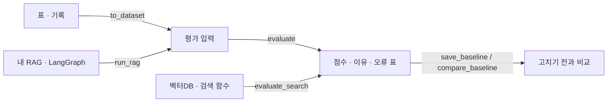

# kgonto-rag-eval

**내 RAG가 어디서 틀리는지 표로 보는 평가 도구입니다.** (v0.3.0)

pandas 표, 벡터DB, LangGraph 그래프를 그대로 넣으면 점수 · 이유 · 오류가 담긴 표를 돌려줍니다.
지표의 프롬프트와 계산이 짧은 코드로 다 보여서, 읽고 고쳐 보는 교재로도 쓸 수 있습니다.



| 하고 싶은 일 | 쓸 것 | 모델 호출 |
|---|---|---|
| 저장해 둔 질문 · 답 기록을 채점 | [`to_dataset`](#1-기록을-채점하기) + `evaluate` | 지표마다 |
| 만든 RAG를 실행해서 채점 | [`run_rag`](#2-내-rag를-실행해서-채점하기) + `evaluate` | RAG + 지표마다 |
| 벡터DB 검색이 맞는 문서를 찾는지 | [`evaluate_search`](#3-검색-채점하기) | 없음(임베딩만) |
| 내 기준으로 채점 | [`@metric` · `judge_metric`](#4-내-지표-만들기) | 없음 / 1번 |
| 답의 출처 표시 검사 | [인용 검사](#인용-검사) | 일부 |
| 고친 뒤 나빠졌는지 | [기준선](#기준선--회귀-테스트) | 없음 |
| 지식그래프로 평가셋 만들기 · 그래프 검사 | [지식그래프](#지식그래프) | 일부 |

## 설치

```bash
pip install "kgonto-rag-eval[kg,pandas] @ git+https://github.com/YTH-Public/kgonto-rag-eval@v0.3.0"
```

| 덧붙이는 이름 | 필요한 때 |
|---|---|
| `pandas` | 결과를 표로(`report.to_pandas()`) |
| `similarity` | `AnswerSimilarity`(scikit-learn) |
| `kg` | 지식그래프 평가셋 만들기(networkx) |

`uv`를 쓰면 `uv pip install ...`로 그대로 바꾸면 됩니다.
모델로 채점하는 지표는 OpenAI 모델이 기본이라 `OPENAI_API_KEY`가 필요합니다(환경변수 또는 `.env`). 다른 LangChain 모델을 `llm=`에 넣을 수 있습니다.

## 1. 기록을 채점하기

```python
from langchain.chat_models import init_chat_model
from kgonto_rag_eval import evaluate, to_dataset
from kgonto_rag_eval.metrics import AnswerCorrectness, Faithfulness

records = [{
    "no": "P001", "question": "청년 월세 지원은 한 달에 얼마까지인가요?",
    "answer": "월 최대 20만 원입니다 [p.35].", "reference": "월 최대 20만 원",
    "found": [{"page": 35, "text": "월 최대 20만 원을 최장 24개월 지원한다."}],
    "expected_facts": ["월 최대 20만 원"],
}]

dataset = to_dataset(records, contexts="found", reference="reference", id="no",     # 내 자료의 열 이름을 적습니다
                     keep=["expected_facts"], source="page")
model = init_chat_model("openai:gpt-6-luna", reasoning_effort="none")
report = evaluate(dataset, [Faithfulness(), AnswerCorrectness()], llm=model)

report.summary                              # 지표별 평균
report.stats                                # 유효 · 누락 · 오류 수 - 평균이 몇 건에서 나왔는지
report.to_pandas()                          # 문항마다 점수 · 이유 · 세부 · 오류
report.explain("P001", "faithfulness")      # 한 칸의 이유 (모델을 다시 부르지 않음)
```

- `records`는 pandas 표나 사전 목록입니다. 근거 칸은 글자 목록, LangChain `Document` 목록, `{"text": ...}` 사전 목록을 받습니다.
- 없는 열, 겹친 번호, 잘못된 모양은 **몇 번째 기록의 어느 칸인지** 알려 주고 멈춥니다. 기준 답이 빈 칸인 것은 괜찮습니다.
- `source="page"`를 적으면 근거의 쪽 번호를 `metadata["retrieved_ids"]`에 남깁니다(출처 검사에 씀).
- 문항이 많으면 `evaluate(..., max_workers=4)`로 함께 채점합니다.

## 2. 내 RAG를 실행해서 채점하기

```python
from kgonto_rag_eval import evaluate, run_rag

questions = [{"no": "P001", "q": "청년 월세 지원은 얼마까지인가요?", "정답": "월 최대 20만 원"}]
rag_data = run_rag(graph, questions, question="q", reference="정답", id="no",
                   contexts="tool", skip=["관련 근거 없음"])      # 도구가 돌려준 글을 근거로
rag_report = evaluate(rag_data, [Faithfulness()], llm=model)
```

| 내 RAG | 넣는 법 | 근거 |
|---|---|---|
| LangGraph 에이전트(`messages`) | `run_rag(graph, ..., contexts="tool")` | 도구가 돌려준 글. `tools=["search"]`로 도구를 고를 수 있음 |
| 상태에 근거 칸이 있는 그래프 | `run_rag(graph, ..., contexts="evidence")` | 그 칸의 목록 |
| 상태 칸이 다른 그래프 | `run_rag(lambda q: graph.invoke({"question": q}), ..., answer="답 칸", contexts="근거 칸")` | 그 칸의 목록 |
| 체인 · 함수 | `run_rag(chain.invoke, ..., contexts=None)` | 없음(답만 채점) |

- 질문마다 한 번씩 순서대로 실행하고, 기준 답은 RAG에 넘기지 않습니다. 한 문항이라도 실패하면 어느 문항인지 알리고 멈춥니다.
- 체크포인터가 있는 그래프는 문항마다 새 대화방(`thread_id`)으로 실행해 대화가 섞이지 않게 합니다.
- 부른 도구는 `metadata["tools_used"]`에 남습니다. 도구를 안 부른 것과, 불렀는데 못 찾은 것을 구별할 수 있습니다.

## 3. 검색 채점하기

```python
from kgonto_rag_eval import evaluate_search

questions = [{"질문": "월세를 도와주는 제도", "쪽": 35}, {"질문": "교육비 지원 두 가지", "쪽": [40, 64]}]
report = evaluate_search(store, questions, question="질문", gold="쪽", key="page", k=3)   # 벡터DB 그대로
report.summary        # {"hit@3": ..., "mrr@3": ..., "recall@3": ...}
report.to_pandas()    # 질문마다 찾은 문서와 순위
```

- `store`는 `similarity_search`가 있는 벡터DB(PGVectorStore · Chroma · InMemoryVectorStore 등)나 **검색 함수**(질문 -> `Document` 목록 또는 ID 목록)입니다. BM25, RRF, 리랭커를 함수로 넣으면 같은 표로 비교됩니다.
- `hit@k` = 정답을 하나라도 찾았나, `mrr@k` = 첫 정답이 몇 번째인가(1 / 순위), `recall@k` = 정답 가운데 몇 개를 찾았나(정답이 둘 이상인 질문이 있을 때만).
- 검색이 실패한 질문은 0점이 아니라 **오류**로 남습니다.

## 4. 내 지표 만들기

함수 하나가 지표 하나입니다. 클래스를 만들지 않아도 됩니다.

```python
from kgonto_rag_eval import judge_metric, metric

@metric
def has_source(sample):                      # 모델을 부르지 않는 지표
    return "[p." in sample.response

@metric
def fact_hit(sample):                        # 점수, 이유, 세부를 함께
    facts = sample.metadata["expected_facts"]
    hits = [fact for fact in facts if fact in sample.response]
    return len(hits) / len(facts), f"{len(hits)}개 찾음", {"hits": hits}

polite = judge_metric("친절함", "존댓말로 답했고, 다음에 할 일을 알려 주었으면 통과")   # 모델이 판정

report = evaluate(dataset, [has_source, fact_hit, polite], llm=model)
```

- 돌려줄 수 있는 것: `True` / `False`, 0 ~ 1 숫자, `(점수, 이유)`, `(점수, 이유, 세부 사전)`, `None`(채점 대상 아님). 그 밖의 값이나 예외는 그 칸만 오류로 남습니다.
- 모델을 쓰는 함수 지표는 `@metric(needs_llm=True)` + `def 이름(sample, llm)`.
- `judge_metric`은 기본으로 질문과 답만 봅니다. 기준 답이나 근거를 보여 주려면 `fields=("user_input", "response", "reference")`처럼 고릅니다. 보내는 글은 `polite.messages(sample)`로 볼 수 있습니다.
- 점수식과 프롬프트를 세밀하게 다루려면 `Metric`을 상속해도 됩니다(아래 지표들이 그렇게 되어 있습니다).

## 들어 있는 지표

| 지표 | 무엇을 보나 | 필요한 것 |
|---|---|---|
| `Faithfulness` | 답의 주장 중 검색된 근거가 뒷받침하는 비율 | 근거 |
| `ContextRelevance` | 근거마다 관련 있음 · 일부 · 없음 판정의 평균 | 근거 |
| `ContextPrecision` | 관련 있는 근거가 위에 있는지(average precision) | 근거 |
| `ContextRecall` | 기준 답의 핵심 주장 중 근거에 있는 비율 | 근거 · 기준 답 |
| `AnswerCorrectness` | 사실 P/R의 F1 × 0.6 + 의미 적합도 × 0.4 | 기준 답 |
| `AnswerRelevancy` | 질문의 의도 중 답이 다룬 비율 - 장황함 감점 | 없음 |

골라 쓰는 지표입니다(`CORE_METRICS` · `ALL_METRICS`에는 없음).

| 지표 | 무엇을 보나 | 필요한 것 | 호출 |
|---|---|---|---:|
| `FactCoverage` | 필수사실마다 있음 · 빠짐 · 어긋남과 답의 근거 문구 | `metadata["expected_facts"]` | 1 |
| `AnsweredRelevancy` | 답했는지 먼저 봄. 답하지 않았으면 0 | 없음 | 1 ~ 2 |
| `FactHit` | 필수사실이 글자 그대로 있는 비율(정답률 아님) | `metadata["expected_facts"]` | 0 |
| `CitedRetrieved` | 답의 출처 가운데 실제로 검색된 자료의 비율 | `metadata["retrieved_ids"]` | 0 |
| `AnswerSimilarity` | 답과 기준 답의 임베딩 유사도 | 기준 답 · 임베딩 | 임베딩 1 |

- 점수는 0 ~ 1입니다. 모델이 채점하는 지표의 `verdict`는 0.8 이상 pass, 0.5 이상 partial, 나머지 fail입니다.
- `FactCoverage`는 필수사실 **밖의** 틀린 내용을 보지 않습니다. `AnswerCorrectness` · `Faithfulness`와 함께 읽습니다. 필수사실에는 대상과 조건을 함께 적습니다.
- `AnsweredRelevancy`가 0이라고 나쁜 답은 아닙니다. 근거가 없을 때의 거절은 옳은 답일 수 있습니다.
- `AnswerSimilarity`는 숫자나 부정이 틀려도 높게 나옵니다. 실제로 정책 질문 40개에서 짧은 기준 답과 비교한 맞은 답(0.43)이 틀린 답(0.65)보다 낮은 일이 있었습니다. 그래서 합격선을 두지 않습니다.
- 채점하는 모델과 답을 만든 모델이 같으면 후하게 채점하는 경향이 있습니다. 중요한 평가는 다른 모델로 교차하고 표본을 사람이 봅니다.
- 판정 모델의 출력이 규칙을 어기면(개수가 음수 등) 점수를 만들지 않고 `error`로 남깁니다.

`diagnose(report)`는 점수를 조합해 의심할 곳(검색 · 생성 · 거절)을 찾아 줍니다. 원인을 확정하지는 않습니다.

<details>
<summary><b>다른 도구와 지표 정의 비교 (RAGAS · DeepEval)</b></summary>

이름이 같아도 계산이 다릅니다. 점수를 도구끼리 평균 내거나 승자를 정하지 마세요.

| 지표 | RAGAS 논문(2309.15217) | RAGAS 0.4.4 | DeepEval 4.3.4 | 이 패키지 |
|---|---|---|---|---|
| Faithfulness | 답의 주장 중 문맥에서 추론되는 비율 | 같은 방식(주장 나누기 → 판정) | 주장마다 YES / BORDERLINE / NO 판정. 기본 `penalize_ambiguous_claims=False` 라 BORDERLINE 도 통과(근거에 없지만 모순도 아닌 주장이 통과할 수 있음), True 면 YES 만 | 주장 지원 비율, 근거 없는 주장 목록 |
| Answer relevancy | 답에서 질문을 거꾸로 만들어 원질문과 임베딩 유사도 | 같은 방식(코사인 평균, 모든 질문이 얼버무림이면 0. 척도가 낮게 나올 수 있음) | 답에서 뽑은 statement 판정 중 YES + BORDERLINE 비율 | 질문 의도 중 다룬 비율 - 장황함 감점(임베딩 안 씀) |
| Context relevance | 문맥에서 필요한 문장 비율 | 두 판정 프롬프트가 낸 0 · 1 · 2 등급을 각각 2로 나눠 평균(0 ~ 1) | (Contextual Relevancy) 모든 문맥 조각의 statement 판정을 펼친 YES 비율 | 문맥 조각마다 3단계 판정 평균 |
| Context precision | (논문에 없음) | reference 있는 판 `ContextPrecision`, 없는 판 `ContextUtilization`(생성된 답을 참고) | 질문 + 기대 답으로 조각마다 유용성을 판정해 만든 average precision | 질문만으로 관련 표시를 만든 average precision |
| Context recall | (논문에 없음) | 정답의 statement 중 문맥에 근거가 있는 비율 | 기대 답의 지원 판정 YES 비율 | 정답 주장 중 근거가 있는 비율, 질문을 함께 줌 |
| Answer correctness | (논문에 없음) | 사실 F-score 0.75 + 의미 유사도 0.25(기본) | G-Eval 등으로 직접 정의 | 사실 P/R 의 F1 0.6 + 의미 적합도 0.4 |

DeepEval은 `eval_mode`에 따라 판정 경로가 달라지므로 비교할 때는 `eval_mode="llm"`으로 고정하세요.
빈 입력 처리도 도구마다 다릅니다(NaN · 0 · 1). 비교 표에는 결측 · 빈 주장 · 호출 실패를 따로 적으세요.

</details>

## 기준선 · 회귀 테스트

```python
from kgonto_rag_eval import compare_baseline, save_baseline

save_baseline(report, "baseline.json", meta={"dataset": "policy-v1"})
result = compare_baseline(new_report, "baseline.json", tolerance=0.1)
assert result["ok"], result
```

- 같은 `sample_id`끼리, 양쪽 모두 점수가 있는 문항만 짝지어 비교합니다. 점수가 있던 칸이 비면(`lost`) 실패합니다.
- `strict_meta=True`를 주면 **채점 조건이 같은지** 먼저 봅니다 - 패키지 판, 판정 모델, 지표의 코드와 설정, 문항과 정답. 함수 지표는 함수 본문과, 함수가 가져다 쓴 바깥의 글자 · 숫자 · 함수까지 봅니다. 바깥의 객체 속은 보지 못하니 `run_meta={"conditions": {...}}`에 판 이름을 적으세요. `run_meta`에 키나 비밀번호를 넣지 마세요.
- 모델 판정은 실행마다 흔들립니다. 허용 폭(`tolerance`)과 반복 횟수를 정해 두세요.

## 인용 검사

```python
from kgonto_rag_eval import citation_support, quote_in_source, resolve_citations, split_cited_sentences

corpus = {"35": "...35쪽 원문...", "36": "...36쪽 원문..."}
answer = "월 최대 20만 원입니다 [p.35]. 최장 24개월입니다 [p.36]."

split_cited_sentences(answer)                             # 문장마다 출처 ID
resolve_citations(["35", "99"], corpus)                   # 1) 출처가 실제 자료에 있나
quote_in_source("월 최대 20만 원", corpus["35"])            # 2) 인용 문구가 원문에 그대로 있나
citation_support(answer, corpus, model, question="...")   # 3) 그 자료가 문장을 뒷받침하나 (모델)
```

세 검사는 서로 다릅니다. 같은 쪽에 같은 숫자가 있어도 다른 대상의 숫자일 수 있습니다.

<details>
<summary><b><code>citation_support</code>가 ALCE 논문과 다른 점</b></summary>

ALCE(Gao et al. 2023, arXiv:2305.14627)의 citation recall / precision 아이디어를 줄인 수업용 지표입니다.
- 판정을 NLI 모델(AutoAIS) 대신 LLM이 합니다.
- recall 분모는 **출처를 단 문장**만입니다(ALCE는 출처 없는 문장도 0으로 세어 전체 문장을 분모로 씀). 출처 없는 문장 수는 `uncited`로 따로 봅니다.
- 풀리지 않는 ID는 빼고 나머지 출처로 판정합니다. precision 분모는 출처 표시 횟수입니다.
- 판정 호출이 실패한 문장은 0점이 아니라 `errors`로 셉니다.
- 잘못 적은 출처 범위([p.9-3], 50쪽을 넘는 범위)는 `CitedRetrieved`가 맞지 않은 출처로 셉니다.

</details>

## 두 답 비교

```python
from kgonto_rag_eval import pairwise_judge
pairwise_judge(question, answer_a, answer_b, model, criteria="금액 · 기간 · 대상 조건이 정확한가")
# {"ab": "A", "ba": "B", "consistent": False, "final": "inconsistent"}
```

순서를 바꿔 두 번 묻고, 두 결과가 다르면 승자를 정하지 않습니다(위치 편향, MT-Bench arXiv:2306.05685).

## 지식그래프

```python
from kgonto_rag_eval.kg import (
    compare_kg, generate_testset_from_kg, leakage_report, load_kg, save_jsonl, schema_violation_rate, to_eval_dataset, validate_item,
)

# 평가셋 초안 만들기 -> 자동 검사 -> 사람이 keep / edit / drop
graph = load_kg(entities="entities.json", relations="relations.json")
items = generate_testset_from_kg(graph, model, max_per_type=6)
print([validate_item(item) for item in items], leakage_report(items))
items[0].review_status = "keep"
save_jsonl(items, "evalset.jsonl")
dataset = to_eval_dataset(items, rag_fn=my_rag)             # my_rag(question) -> (answer, 실제로 검색된 contexts)

# 추출한 그래프를 정답과 비교 (모델 없음)
compare_kg(pred_rows, gold_rows, normalize=lambda s: s.replace("(주)", ""), scope=("rcept_no",))
schema_violation_rate(entities, relations, allowed_types={"회사", "품목"},
                      allowed_patterns={("회사", "공급", "회사"), ("회사", "매입", "품목")})
```

| 함수 | 보는 것 | 근거 · 성격 |
|---|---|---|
| `compare_kg` | 추출 KG vs 정답 트리플 P / R / F1, 누락 · 추가 | 트리플 P/R/F1 (Mondal et al. 2021, arXiv:2106.01167) |
| `check_ontology` · `schema_violation_rate` | 허용 타입 · 관계 · 패턴 · dangling 위반 | W3C SHACL의 동기. 추론 엔진 아님 |
| `non_isolated_node_ratio` | 관계를 가진 노드 비율 | 이 프로젝트의 구조 보조 지표 |
| `path_entity_recall` | 정답 경로 이름이 검색 결과에 나온 비율(방향은 안 봄) | Recall@k를 경로 이름에 옮긴 이 프로젝트의 지표 |
| `triple_coverage` | 정답 근거 트리플을 검색 트리플이 덮은 비율(방향까지) | RAGAS context recall의 생각을 트리플에 옮긴 것 |
| `source_traceability` | 출처 칸이 있는 비율 | 출처가 **붙었는지**만 봄 |

- `validate_item`을 통과해도 진짜 multi-hop이라는 보장은 아닙니다. 핵심 관계 하나를 가려도 답할 수 있는지 사람이 확인하세요.
- 평가셋을 만든 KG와 채점 정답이 같은 KG라서 생기는 순환은 코드로 잡을 수 없습니다.
- `normalize`를 넓게 잡으면(모든 괄호 · 공백 제거) 서로 다른 대상이 합쳐집니다.

## 왜 만들었나

RAGAS, DeepEval은 좋은 도구입니다. 다만 수업에서 쓰다 보니 이런 일이 있었습니다.

- RAGAS는 0.4.3(2026-01) 뒤로 정식 릴리스가 10개월 비었습니다. 그동안 `import ragas`가 깨지고 새 OpenAI 모델에서 거부당했습니다(0.4.4, 2026-11-14에서 고쳐짐).
- DeepEval은 이름이 계속 바뀝니다(`GPTModel` → `OpenAIModel`, `LLMTestCaseParams` → `SingleTurnParams`).
- **같은 이름의 지표도 도구마다 정의가 다릅니다.**

그래서 두 도구의 좋은 관례(`EvaluationDataset`, metric 객체, `evaluate()`)를 따르되, 프롬프트와 계산이 다 보이는 짧은 코드로 다시 썼습니다.
기존 도구를 대신하기보다 함께 놓고 비교하는 용도를 권합니다. 의존성은 `langchain`, `langchain-openai`, `pydantic`입니다.

## 한계

- 점수는 그 평가자 · 프롬프트 아래의 상대 지표입니다. 변경 전후 비교와 사람 검수 표본으로 쓰세요.
- 검색 채점의 질문과 정답이 문서의 낱말을 그대로 쓰면 점수가 높게 나옵니다. 사용자가 실제로 쓰는 말로도 재 보세요.
- 작은 그래프는 의미 있는 multi-hop 질문 수가 적습니다.

## 근거 (논문 · 표준)

- **RAGAS** - Es et al., [arXiv:2309.15217](https://arxiv.org/abs/2309.15217). 원 논문이 정의한 것은 faithfulness · answer relevance · context relevance 셋입니다. context precision / recall · answer correctness는 그 뒤 라이브러리가 더한 지표이고, 이 패키지의 프롬프트 · 가중치(0.6 / 0.4 등)는 이 프로젝트가 정한 것입니다.
- **ALCE** - Gao et al., [arXiv:2305.14627](https://arxiv.org/abs/2305.14627) - `citation_support`
- **MT-Bench** - Zheng et al., [arXiv:2306.05685](https://arxiv.org/abs/2306.05685) - `pairwise_judge`
- **KG 구축 P/R/F1** - Mondal et al., [arXiv:2106.01167](https://arxiv.org/abs/2106.01167) - `compare_kg`
- **W3C SHACL** - [w3.org/TR/shacl](https://www.w3.org/TR/shacl/) - 스키마 검사의 동기
- **GraphRAG-Bench** - [arXiv:2506.02404](https://arxiv.org/abs/2506.02404) - 구축 · 검색 · 생성을 나눠 보는 관점

## 옮겨 올 때

기존 지표의 이름 · 프롬프트 · 점수식은 0.2와 같습니다. 판마다 바뀐 것은 [CHANGELOG.md](CHANGELOG.md)에 있습니다.

<details>
<summary><b>v0.1에서 옮겨 올 때</b></summary>

- `load_kg`는 MultiDiGraph를 돌려줍니다. `g[u][v]["relation"]` 대신 `for u, v, rel in g.edges(keys=True)`처럼 관계를 모두 읽으세요.
- `EvalSample.retrieved_contexts`에 문자열 하나를 주면 오류입니다. `[텍스트]`로 넣으세요.
- 지표 점수가 반올림되지 않습니다. 표시용은 `report.summary`를 쓰세요.
- `compare_kg(..., scope=...)`에서 범위 칸이 빈 행은 오류입니다.
- `path_recall`은 `path_entity_recall`의 옛 이름입니다.
- 사업보고서 정답처럼 `@제출회사` 치환 · 블록 범위 · 부분 정답(`partial`)이 있는 자료는 이 함수 앞에서 직접 전처리하세요.

</details>

## 개발

```bash
git clone https://github.com/YTH-Public/kgonto-rag-eval.git
cd kgonto-rag-eval
pip install -e ".[kg,pandas,similarity]" pytest
pytest                 # API 없이 도는 테스트. 실호출 테스트는 tests/live/ (OPENAI_API_KEY 필요)
```

MIT 라이선스입니다.
